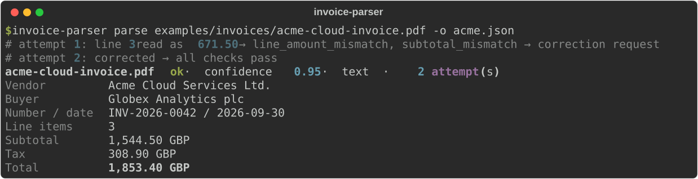
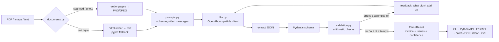

<div align="center">

# invoice-parser-llm

**Turn invoice and receipt PDFs or photos into validated, structured JSON, using any OpenAI-compatible LLM. Built-in arithmetic checks catch the numbers the model misreads.**

[](https://github.com/Quantum-dev1/invoice-parser-llm/actions/workflows/ci.yml)
[](./pyproject.toml)
[](./LICENSE)




<sub>Real CLI output. The two LLM replies are scripted by <a href="scripts/render_cli_screenshot.py">scripts/render_cli_screenshot.py</a> to show the self-correction loop; everything else runs the real code path.</sub>

</div>

---

LLMs read invoices well. The weak spot is a misread digit: the model returns `671.50` where the paper says `617.50`, and nothing in the output tells you. **invoice-parser-llm** treats the model's answer as a claim and checks it. Line items have to add up to the subtotal, and subtotal − discount + shipping + tax has to equal the total. When the numbers don't reconcile, the model is told exactly what is wrong and asked to re-read the document. Every result includes a confidence score and a `needs_review` flag, so your pipeline knows which invoices a person should look at.

It works with **any OpenAI-compatible endpoint**: OpenAI, OpenRouter, Ollama, vLLM, LM Studio, llama.cpp server. You choose the base URL, model and key, and the library has no vendor lock-in.

## Features

- **📄 PDFs, scans and photos**: digital PDFs → text via `pdfplumber` (with `pypdf` fallback). Scanned PDFs with no text layer are rendered to images, and PNG/JPEG/WebP/TIFF photos go to a **vision model** automatically.
- **🧱 Strict schema**: Pydantic v2 models for vendor, buyer, dates, currency (ISO 4217), line items, multiple tax lines, discounts, shipping, totals, paid/due. Money is `Decimal` internally and plain JSON numbers on output.
- **🧮 Arithmetic validation**: line `qty × price`, Σ lines vs subtotal, Σ tax lines vs tax total, `rate × base` per tax line, the grand-total equation, total − paid vs amount due, plus sanity checks (due before issue date, negative non-credit totals, missing key fields). Tolerance grows with the number of summed terms to allow for rounding.
- **🔁 Self-correction loop**: invalid JSON, schema errors and arithmetic errors are sent back to the model with specific feedback. The prompt forbids "fixing" numbers just to make them add up, so documents that really are inconsistent still get flagged. If every attempt has errors, the best one is kept.
- **🎯 Confidence + review flag**: a transparent heuristic score (documented below) and `needs_review` for routing to a person.
- **🧾 Forgiving input parsing**: handles `1,234.56`, `1.234,56`, `€ 99,30`, `(12.00)`, "March 3, 2026" and `{"invoice": {...}}` wrappers in code fences. Ambiguous numeric dates such as `03/04/2026` are rejected, so the model has to resolve them.
- **📦 Batch mode**: a whole folder in parallel → **JSONL**, a **one-row-per-invoice CSV** and a **one-row-per-line-item CSV** for spreadsheets. One bad file doesn't stop the batch.
- **📊 Accuracy evaluation**: `invoice-parser eval` scores field-level accuracy against your labeled JSON, so you can compare models, endpoints and settings on your own documents.
- **🌐 HTTP API + Docker**: FastAPI service with upload size limits, optional bearer-token auth, and a `/v1/validate` endpoint that runs the checks without calling an LLM. Runs as a non-root container with a health check.
- **🔌 Pluggable**: pass any object with a `complete(messages)` method to use another backend or a mock. The bundled client is plain `httpx` with no vendor SDK. It retries on 429 and 500/502/503/504 responses with backoff and turns off JSON mode automatically on servers that don't support `response_format`.

## Quick start

```bash
pip install "invoice-parser-llm[api] @ git+https://github.com/Quantum-dev1/invoice-parser-llm"

# Point it at any OpenAI-compatible endpoint
export INVOICE_LLM_BASE_URL=https://api.openai.com/v1
export INVOICE_LLM_API_KEY=...            # not needed for local Ollama/vLLM
export INVOICE_LLM_MODEL=gpt-4o-mini      # any chat model; use a vision-capable one for scans/photos

invoice-parser parse examples/invoices/acme-cloud-invoice.pdf
```

Or from a clone:

```bash
git clone https://github.com/Quantum-dev1/invoice-parser-llm.git && cd invoice-parser-llm
python -m venv .venv && . .venv/bin/activate
pip install -e ".[dev]"
pytest                      # 102 tests, no network, no API key needed
```

### Local models with Ollama (no data leaves your machine)

```bash
export INVOICE_LLM_BASE_URL=http://localhost:11434/v1
export INVOICE_LLM_MODEL=qwen2.5:7b               # text model for digital PDFs
export INVOICE_LLM_VISION_MODEL=llama3.2-vision   # used for scans and photos
invoice-parser batch ./inbox --csv invoices.csv
```

## Configuration

All settings come from environment variables (see [`.env.example`](.env.example)). No keys or endpoints are hardcoded.

| Variable | Default | Description |
| --- | --- | --- |
| `INVOICE_LLM_MODEL` | — (required) | Chat model name |
| `INVOICE_LLM_BASE_URL` | `https://api.openai.com/v1` | Any OpenAI-compatible base URL (falls back to `OPENAI_BASE_URL`) |
| `INVOICE_LLM_API_KEY` | — | Bearer key, optional for local servers (falls back to `OPENAI_API_KEY`) |
| `INVOICE_LLM_VISION_MODEL` | same as model | Model for images and scanned PDFs |
| `INVOICE_LLM_JSON_MODE` | `true` | Send `response_format: json_object` (auto-disabled if the server rejects it) |
| `INVOICE_LLM_TIMEOUT` | `120` | Request timeout, seconds |
| `INVOICE_LLM_MAX_RETRIES` | `2` | HTTP retries on 408/409/425/429/500/502/503/504 and network errors |
| `INVOICE_LLM_TEMPERATURE` | `0` | Sampling temperature |
| `INVOICE_MAX_ATTEMPTS` | `3` | Extraction attempts including self-corrections |
| `INVOICE_TOLERANCE` | `0.01` | Allowed difference per summed term |
| `INVOICE_MAX_PAGES` | `5` | Pages processed per document |
| `INVOICE_MIN_TEXT_CHARS` | `40` | Below this many non-blank chars per page, a PDF is treated as scanned |
| `INVOICE_IMAGE_DPI` | `150` | Render resolution for scanned PDF pages |
| `INVOICE_API_TOKEN` | — | If set, the API requires `Authorization: Bearer <token>` |
| `INVOICE_MAX_UPLOAD_MB` | `15` | API upload limit |

| Provider | `INVOICE_LLM_BASE_URL` |
| --- | --- |
| OpenAI | `https://api.openai.com/v1` |
| OpenRouter | `https://openrouter.ai/api/v1` |
| Ollama | `http://localhost:11434/v1` |
| vLLM | `http://localhost:8000/v1` |
| LM Studio | `http://localhost:1234/v1` |

## Usage

### CLI

```bash
invoice-parser parse invoice.pdf                       # full result JSON to stdout + summary to stderr
invoice-parser parse receipt.jpg --invoice-only -o receipt.json
invoice-parser parse invoice.pdf --strict              # exit code 2 when needs_review

invoice-parser batch ./inbox -o results.jsonl --csv summary.csv --items-csv lines.csv --workers 8

invoice-parser eval ./labeled/docs ./labeled/truth --report eval.json   # field-level accuracy

invoice-parser validate invoice.json                   # arithmetic checks only, no LLM
invoice-parser schema                                  # JSON Schema of the invoice object
invoice-parser serve --host 0.0.0.0 --port 8000        # HTTP API
```

### Python

```python
from invoice_parser_llm import InvoiceParser

parser = InvoiceParser()                          # reads INVOICE_LLM_* from the environment
result = parser.parse("invoice.pdf")              # path or bytes (pass filename= with bytes)

if result.needs_review:
    for issue in result.issues:
        print(issue.severity, issue.code, issue.message)
else:
    invoice = result.invoice
    print(invoice.vendor.name, invoice.total, invoice.currency)   # Decimal amounts
    payload = result.model_dump(mode="json")                      # JSON-ready dict
```

Explicit configuration and a custom backend:

```python
from invoice_parser_llm import InvoiceParser, OpenAICompatibleClient, Settings

client = OpenAICompatibleClient(model="my-model", base_url="http://gpu-box:8000/v1", api_key=None)
parser = InvoiceParser(client=client, settings=Settings(model="my-model", max_attempts=4))

# Any object with `.model` and `.complete(messages) -> LLMResponse` works too: tests use a scripted fake.
```

Validation on its own, for data you already have:

```python
from invoice_parser_llm import Invoice, validate_invoice

issues = validate_invoice(Invoice.model_validate(my_json), tolerance="0.02")
```

### HTTP API

```bash
docker build -t invoice-parser-llm .
docker run -p 8000:8000 \
  -e INVOICE_LLM_BASE_URL=https://api.openai.com/v1 \
  -e INVOICE_LLM_API_KEY=... -e INVOICE_LLM_MODEL=gpt-4o-mini \
  -e INVOICE_API_TOKEN=change-me \
  invoice-parser-llm

curl -H "Authorization: Bearer change-me" -F file=@invoice.pdf http://localhost:8000/v1/parse
```

| Method | Path | Description |
| --- | --- | --- |
| `POST` | `/v1/parse` | Multipart upload (`file`) → `ParseResult`. 413 if too large, 415 unsupported, 502 LLM failure, 503 not configured |
| `POST` | `/v1/validate` | Invoice JSON → list of issues (no LLM call) |
| `GET` | `/v1/schema` | Invoice JSON Schema |
| `GET` | `/healthz` | Liveness + whether a model is configured |
| `GET` | `/docs` | Interactive OpenAPI docs |

### Output

<details>
<summary>Example <code>ParseResult</code> (receipt)</summary>

```json
{
  "file": "northwind-receipt.pdf",
  "invoice": {
    "document_type": "receipt",
    "invoice_number": "R-58213",
    "issue_date": "2026-10-02",
    "due_date": null,
    "currency": "USD",
    "vendor": { "name": "Northwind Coffee Roasters", "address": "1200 Harbor Blvd, Bayview",
                "tax_id": "00-0000000", "email": null, "phone": "(555) 010-2030" },
    "buyer": null,
    "line_items": [
      { "description": "Cappuccino", "sku": null, "quantity": 2, "unit": null, "unit_price": 4.75, "tax_rate": null, "amount": 9.5 },
      { "description": "Blueberry muffin", "sku": null, "quantity": 1, "unit": null, "unit_price": 3.95, "tax_rate": null, "amount": 3.95 },
      { "description": "Single-origin beans 340g", "sku": null, "quantity": 1, "unit": null, "unit_price": 18, "tax_rate": null, "amount": 18 }
    ],
    "subtotal": 31.45,
    "discount_total": null,
    "shipping_total": null,
    "taxes": [{ "name": "Sales tax", "rate": 8.25, "base": 31.45, "amount": 2.59 }],
    "tax_total": 2.59,
    "total": 34.04,
    "amount_paid": 34.04,
    "amount_due": 0,
    "payment_terms": null,
    "notes": null
  },
  "confidence": 1.0,
  "needs_review": false,
  "issues": [],
  "attempts": 1,
  "extraction": "text",
  "model": "your-model",
  "warnings": [],
  "usage": { "prompt_tokens": 100, "completion_tokens": 50 }
}
```

</details>

### Validation checks

| Code | Severity | Check |
| --- | --- | --- |
| `line_amount_mismatch` | error | `quantity × unit_price ≠ amount` on a line |
| `subtotal_mismatch` | error | Σ line amounts ≠ subtotal |
| `line_items_tax_inclusive` | warning | lines sum to subtotal + tax (gross pricing), reported instead of an error |
| `tax_total_mismatch` | error | Σ tax lines ≠ tax total |
| `tax_rate_mismatch` | warning | `base × rate` ≠ tax line amount |
| `total_mismatch` | error | subtotal − discount + shipping + tax ≠ total |
| `amount_due_mismatch` | warning | total − paid ≠ amount due |
| `missing_total` | error | no grand total |
| `missing_vendor` / `missing_currency` / `missing_issue_date` / `missing_invoice_number` | warning | key fields absent (invoice number not required for receipts) |
| `due_before_issue`, `negative_total` | warning | sanity checks |

**Confidence** starts at 1.0 and goes down by 0.30 per error, 0.05 per warning, 0.05 per extra attempt, 0.05 for the vision path and 0.10 when the text was truncated. `needs_review` is true when any error remains or confidence < 0.75. This is a heuristic based only on validation signals, not a calibrated probability.

## Architecture



```
src/invoice_parser_llm/
├── documents.py   # format sniffing, PDF text extraction, scanned-PDF rendering, image normalization
├── prompts.py     # system prompt with schema skeleton (kept in sync with the model by a test), feedback prompts
├── llm.py         # httpx client for /chat/completions: retries, backoff, JSON-mode fallback
├── schema.py      # Pydantic v2 models, lenient money/date/currency parsing
├── validation.py  # deterministic arithmetic + consistency checks
├── parser.py      # the attempt loop, best-attempt selection, confidence
├── batch.py       # concurrent folder processing, JSONL/CSV writers
├── evaluation.py  # field-level accuracy vs ground truth
├── cli.py         # Typer CLI
└── api.py         # FastAPI app
```

Design choices:
- **Validation is deterministic and has no LLM in it.** The model is never asked whether the numbers add up. That is computed with `Decimal`.
- **Corrections never invent data.** The feedback names the specific mismatch and asks for a re-read. Documents that are actually inconsistent are flagged, not "fixed".
- **Text first, vision second.** Text extraction is cheaper and more precise on digital PDFs. Vision is used only when a page has no usable text layer.

## Sample data

`examples/` contains three synthetic invoices with **clearly fictional companies** (every page carries a "SAMPLE DOCUMENT" footer), plus ground-truth JSON for each:

| File | What it exercises |
| --- | --- |
| `acme-cloud-invoice.pdf` | GBP, 20% VAT, fractional hours |
| `northwind-receipt.pdf` | narrow till receipt, USD sales tax, paid by card |
| `initech-office-supplies.pdf` | EUR with `1.234,56` number format, discount, shipping, two VAT rates |
| `initech-office-supplies-photo.jpg` | tilted, noisy "phone photo" → vision path |
| `initech-office-supplies-scanned.pdf` | image-only PDF → scanned-PDF fallback |

Regenerate them with `python examples/generate_samples.py` (deterministic). To measure a model on them:

```bash
invoice-parser eval examples/invoices examples/expected
```

## Testing

```bash
pytest --cov          # 102 tests, ~95% coverage, no network
ruff check . && ruff format --check . && mypy
```

The suite uses a scripted fake LLM, so it needs no network or API key. It also covers the real HTTP client against a local stub server that speaks the OpenAI chat-completions protocol. It does **not** include accuracy numbers for real models: run `invoice-parser eval` with your own endpoint to get those.

## Roadmap

- [ ] Optional OCR text layer (e.g. Tesseract) for text-only models on scanned documents
- [ ] Structured-output / JSON-schema mode where the endpoint supports it
- [ ] Async client and streaming batch for very large folders
- [ ] Per-field bounding boxes / source spans for UI highlighting
- [ ] Currency-aware rounding rules and more tax regimes (withholding, reverse charge)
- [ ] PyPI release

## Contributing

Issues and PRs are welcome. See [CONTRIBUTING.md](./CONTRIBUTING.md). In short: `pip install -e ".[dev]"`, add tests for your change, and make sure `ruff`, `mypy` and `pytest` pass.

## License

[MIT](./LICENSE) © Quantum Dev

---

Built by [Quantum Dev](https://quantumdevteam.com) — we build web platforms, mobile apps and AI agents. Need something like this for your business? [Book a call](https://cal.com/aleksandr-ganus/30m).
